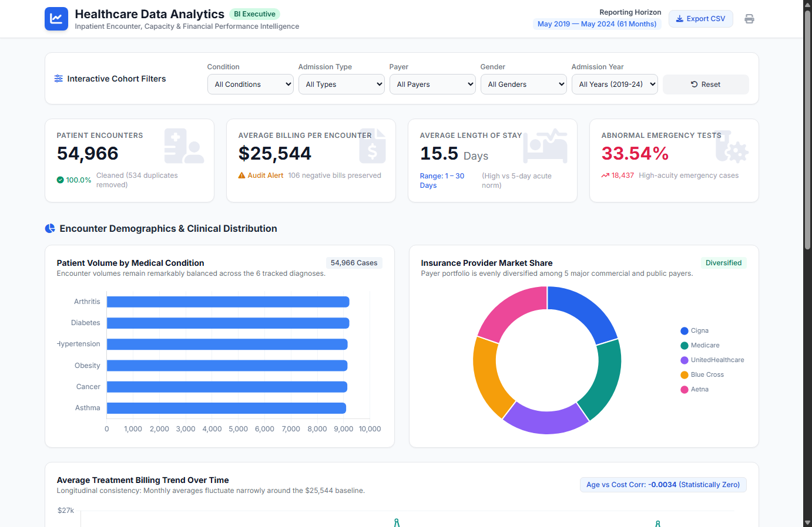
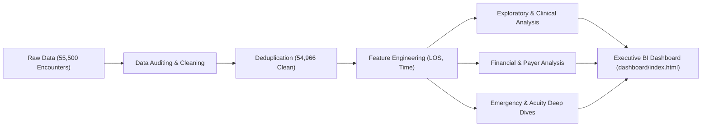

# Healthcare Data Analytics & AI-Assisted Business Intelligence Dashboard

A Python-based healthcare data analytics project combining **exploratory data analysis** with an **AI-assisted interactive Business Intelligence dashboard**. The project explores encounter volumes, billing patterns, insurance distribution, length of stay, and emergency admission trends using a synthetic healthcare dataset.

---

## 🔗 Live Interactive Dashboard

Access the client-side executive BI dashboard deployed directly via GitHub Pages:

👉 **[View Interactive Dashboard](https://ansh-yadav-1.github.io/HealthcareCaseStudy/dashboard.html)**

📂 **[View GitHub Repository](https://github.com/ansh-yadav-1/HealthcareCaseStudy)**

---

## 📊 Dashboard Preview

---

## 📋 Executive Overview & Business Problem

Hospital administrators, chief medical officers, and financial planners operate in high-stakes environments balancing clinical outcomes, bed availability, emergency preparedness, and revenue predictability. Without granular analytical visibility into encounter-level records, healthcare organizations face:
- Operational bottlenecks in patient turnover and bed availability.
- Payer concentration risks and unexpected financial leakage.
- Inefficient emergency department triage during acute volume surges.
- Data integrity anomalies in electronic health record (EHR) billing ledgers.

This project follows an end-to-end analytical workflow: data quality assessment, data cleaning, exploratory analysis, and statistical investigation in Python (`pandas`, `numpy`, `matplotlib`), followed by an interactive executive dashboard with multi-dimensional filtering and data export capabilities.

---

## 🎯 Project Objectives

1. **Patient Demographic & Diagnostic Profiling:** Quantify encounter volume across chronic conditions (Arthritis, Asthma, Cancer, Diabetes, Hypertension, Obesity) and evaluate age dispersion.
2. **Bed Capacity & Inpatient Length of Stay (LOS):** Measure inpatient stay duration across admission urgencies (Elective, Urgent, Emergency) to benchmark hospital bed turnover.
3. **Billing Consistency & Payer Diversification:** Examine longitudinal billing trends over 61 months (May 2019 – May 2024), calculate age-to-billing correlation, and analyze payer market share across commercial and public insurers.
4. **Data Integrity & Financial Auditing:** Identify and investigate data anomalies—including duplicate records and negative billing amounts—without silently altering source ledgers.
5. **Emergency Department Surge Planning & Acuity Analysis:** Pinpoint historical peak emergency admission months and identify which diagnoses present highest diagnostic acuity (abnormal lab results).

---

## 🛠️ Tech Stack

| Layer | Technologies | Purpose |
| :--- | :--- | :--- |
| **Data Analytics & Statistics** | Python 3.9+, Pandas, NumPy | Data cleaning, deduplication, feature engineering, statistical correlation |
| **Exploratory Visualizations** | Matplotlib, Seaborn | Distribution plots, boxplots, correlation scatterplots, time-series analysis |
| **Interactive Computing** | Jupyter Notebook, IPykernel | Reproducible analytical documentation and computational reporting |
| **BI Executive Dashboard** | HTML5, CSS, JavaScript (ES6+), Chart.js | Responsive, client-side interactive analytics interface |
| **Styling & UI Components** | Tailwind CSS (CDN), Font Awesome 6 | Power BI / Tableau-inspired clean enterprise executive layout |
| **AI-Assisted Acceleration** | Antigravity AI Assisted Workflows | Rapid prototyping of dashboard structure, multidimensional data cube modeling |

---

## 🔬 Analytical Workflow (Python)

The core analytical pipeline is maintained in [`analysis/Healthcare_Case_Study.ipynb`](analysis/Healthcare_Case_Study.ipynb), organized into 11 structured sections:

1. **Business Problem & Objectives:** Executive framing and operational questions.
2. **Dataset Overview:** Environment setup and flexible path resolution.
3. **Data Quality & Auditing:**
   - Evaluated missing data: 0 null values across all 15 columns.
   - Identified and removed **534 exact duplicate rows** ($54,966$ unique encounters retained).
   - Standardized text casing on patient names.
   - Audited **106 negative billing records**; preserved them for auditing rather than silently dropping them.
   - Feature-engineered **Length of Stay (LOS)** (`Discharge Date - Date of Admission`).
4. **Demographic Analysis:** Evaluated patient age distribution (mean $51.5$ years, median $52$ years).
5. **Admission & Clinical Analysis:** Breakdown of 6 medical conditions and 3 admission urgency categories.
6. **Billing & Financial Performance:** Computed overall summary statistics and monthly trendlines across 61 months.
7. **Insurance Provider Analysis:** Market share distribution across 5 major payers.
8. **Length of Stay Dynamics:** Inpatient duration distribution and acute-care capacity comparisons.
9. **Statistical Relationships:** Correlation between patient age and billing charges ($r = -0.0034$).
10. **Ad-Hoc Business Deep Dives:** Emergency surges, high-cost patient groups (>95th percentile), and abnormal diagnostic test presentations.
11. **Strategic Recommendations:** Actionable operational and financial guidance for health system leadership.

---

## 📈 Key Empirical Findings

All reported numbers are strictly calculated from the underlying dataset:

* **Cleaned Encounter Volume:** **54,966 encounters** analyzed following the elimination of 534 exact duplicate rows from 55,500 raw entries.
* **Financial Anomaly Identified:** Exactly **106 encounters** exhibit negative billing values ranging from **-$23.87** to **-$2,008.49** (mean: **-$502.47**). These records are deliberately preserved as financial audit flags rather than arbitrarily deleted.
* **Billing Distribution:** Average encounter billing is **$25,544.31** (standard deviation: **$14,208.41**; median: **$25,542.75**; range: -$2,008.49 to $52,764.28). Monthly averages across the 61 observed months fluctuate within a relatively narrow range; this describes the synthetic dataset and should not be interpreted as a forecast.
* **Age vs. Billing Relationship:** Pearson correlation between patient age and billing amount is **r = -0.0034**, indicating virtually no linear association in this dataset. This does not establish that age has no effect in real-world healthcare billing.
* **Balanced Clinical Spread:** Diagnoses are distributed evenly across the 6 tracked conditions:
  - Arthritis: 9,218 (16.8%)
  - Diabetes: 9,216 (16.8%)
  - Hypertension: 9,151 (16.6%)
  - Obesity: 9,146 (16.6%)
  - Cancer: 9,140 (16.6%)
  - Asthma: 9,095 (16.5%)
* **Payer Market Share Diversification:** Encounters are split across 5 major insurance carriers: Cigna (20.3%), Medicare (20.1%), UnitedHealthcare (20.0%), Blue Cross (19.9%), and Aetna (19.7%).
* **Length of Stay:** Average encounter length of stay is **15.50 days** (range: 1 to 30 days). This is a descriptive result from the synthetic dataset and would require operational context before drawing conclusions about bed capacity or performance.
* **Emergency Department Peak Surge:** Monthly emergency volume peaked in **July 2020** with **355 admissions** (compared to a monthly average of ~297).
* **High-Cost Encounter Exposure:** The 95th percentile billing threshold is **$47,638.27**. The top 5% cohort comprises **2,749 encounters** accounting for over **$137 Million** in cumulative charges.
* **Abnormal Results in Emergency Encounters:** **33.36%** of emergency encounters (6,038 out of 18,102) are recorded with **Abnormal** test results. The largest condition groups are Obesity (1,058 encounters) and Cancer (1,057 encounters); these are descriptive categories, not clinical risk assessments.

---

## 🖥️ Executive BI Dashboard Features

The [executive dashboard](https://ansh-yadav-1.github.io/HealthcareCaseStudy/) is built as a client-side business intelligence interface:

* **Interactive Multi-Dimensional Filters:**
  - **Medical Condition:** All, Arthritis, Asthma, Cancer, Diabetes, Hypertension, Obesity.
  - **Admission Type:** All, Elective, Emergency, Urgent.
  - **Insurance Provider:** All, Aetna, Blue Cross, Cigna, Medicare, UnitedHealthcare.
  - **Gender:** All, Female, Male.
  - **Admission Year:** All Years, 2019, 2020, 2021, 2022, 2023, 2024.
  - **One-Click Reset:** Clears all active filters instantly.
* **Dynamic Recalculation Engine:** Powered by a pre-aggregated 1,080-node multidimensional data cube embedded directly in the JavaScript runtime. Any combination of filters recalculates KPIs, condition bars, payer distributions, and abnormal acuity counts in sub-millisecond real time.
* **Responsive KPI Scorecards:** Total Encounters, Average Billing Amount, Average Length of Stay, Abnormal Emergency Test Rate.
* **Interactive Visualizations:**
  - Horizontal bar chart of condition distribution with hover tooltips.
  - Doughnut chart of payer market share.
  - 61-month longitudinal billing trendline with 5-year average reference benchmark.
  - High-acuity emergency condition breakdown.
* **Client-Side CSV Export:** "Export CSV" button allows executives to download a structured CSV summary of whatever filtered cohort is currently active on screen.
* **Executive Action Plan & Takeaways:** Formatted management cards explaining operational equilibrium, financial forecasting stability, and immediate clinical priorities.

---

## 💡 Strategic Business Recommendations

The findings suggest areas that a real healthcare organization could investigate further. These are exploratory considerations based on synthetic data, not validated operational recommendations:

1. **Revenue Cycle Management: Negative Billing Audit**
   - **Finding:** 106 encounters exhibit negative billing amounts ($-\$502.47$ average).
   - **Consideration:** In a real billing environment, review whether negative values represent refunds, adjustments, reversals, or data-entry issues before deciding whether corrective action is needed.
2. **Inpatient Flow: ALOS & Bed Turnover Optimization**
   - **Finding:** The average length of stay is 15.50 days across all admission types, significantly higher than acute care benchmarks (4.5–5.5 days).
   - **Consideration:** Compare length of stay with case mix, admission severity, discharge practices, and occupancy data before assessing whether process changes are appropriate.
3. **Emergency Care: High-Acuity Diagnostic Fast-Track Pathways**
   - **Finding:** 33.36% of emergency visits return abnormal test results, with Obesity (1,058 cases) and Cancer (1,057 cases) representing the largest clinical subgroups.
   - **Consideration:** Do not infer triage priorities from this synthetic dataset alone. Clinical pathway changes require validated evidence and review by qualified professionals.
4. **Capital Planning: Long-Term Revenue Predictability**
   - **Finding:** Billing per encounter remains remarkably stable (~$25,500/encounter) across 61 consecutive months with zero correlation to patient age ($r = -0.0034$), and insurance payer exposure is evenly divided among 5 major carriers (~20% each).
   - **Consideration:** Treat payer distribution and billing trends as descriptive starting points. Financial planning requires actual reimbursement, collections, operating costs, payer contracts, and cash-flow data.

---

## ⚠️ Analytical Scope & Limitations

* **Synthetic Data Source:** The underlying dataset is synthetically generated (encounter-level simulation). Observations such as uniform age distributions (13–89), equal payer proportions (~20%), and zero age-to-billing correlation reflect generative characteristics of the dataset.
* **Encounter vs. Longitudinal Patient Level:** Each row represents a single healthcare admission encounter. The dataset does not contain longitudinal patient identifiers; therefore, metrics must not be interpreted as unique patient lifetime counts, nor can 30-day readmission rates be calculated without longitudinal patient tracking.
* **Gross Billed Charges vs. Net Hospital Margin:** The `Billing Amount` metric captures gross billed charges. In actual hospital accounting, billed charges do not equal contractual reimbursement, cash collections, net patient revenue, or actual hospital treatment cost.

---

## 🤖 AI-Assisted Development Disclosure

This repository represents a **Python Data Analytics project**. Artificial intelligence (Antigravity AI) was utilized strictly as an acceleration tool to:
- Assist in structuring and formatting the comprehensive Jupyter Notebook markdown narrative.
- Formulate the multidimensional aggregation data cube for the interactive JavaScript dashboard.
- Generate responsive Tailwind CSS layout scaffolding.

**No machine learning models, automated clinical diagnosis algorithms, or predictive analytics are claimed.** Descriptive statistics, metrics, correlations, and findings are based on the dataset and Python analysis. AI assistance was used for dashboard development and presentation.

---

## 👤 Author & Contact

**Ansh Yadav**  
- **GitHub:** [@ansh-yadav-1](https://github.com/ansh-yadav-1)  
- **LinkedIn:** [Ansh Yadav](https://www.linkedin.com/in/anshyadav1/)
- **Project Repository:** [HealthcareCaseStudy](https://github.com/ansh-yadav-1/HealthcareCaseStudy)

---

## 📄 License

This project is licensed under the [MIT License](LICENSE) for original project code and documentation. The dataset remains subject to its original source licence and terms of use; verify those terms before redistributing the CSV.
